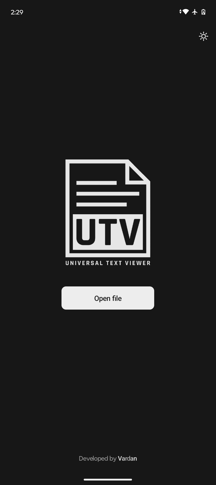
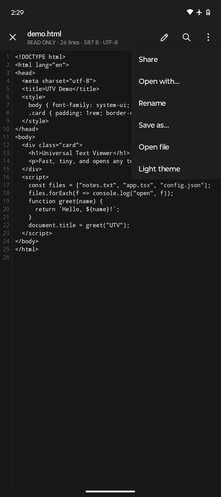
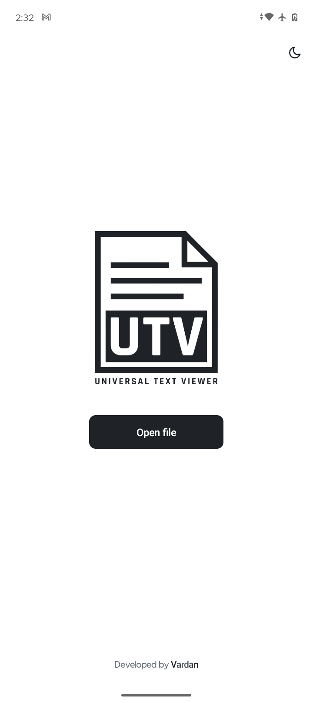
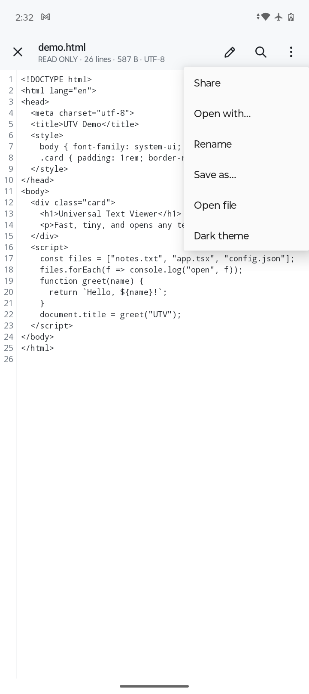

# UTV - Universal Text Viewer

A tiny (**~66 KB APK**) text viewer and editor for Android 


**Dark Mode**

 

**Light Mode**

 

## Features

- Opens any text or code file, even 15 MB / 200k-line logs
- Featherweight: pure Java, zero libraries, no cache, nothing running in the background

## Supported formats

`txt` `md` `log` `csv` `tsv` `json` `xml` `yaml` `yml` `toml` `ini` `conf` `env` `html` `css` `js` `jsx` `ts` `tsx` `py` `java` `kt` `c` `cpp` `h` `cs` `go` `rs` `rb` `php` `swift` `dart` `sh` `bat` `sql` `gradle` `properties` `srt` `tex` and any other plain-text file

## Build

No Gradle. Requires a JDK (17+) and the Android SDK with `build-tools;35.0.0` and `platforms;android-35`.

```sh
./build.sh            # build release APK and install on a connected device
./build.sh noinstall  # build only -> release/UTV-v1.0.apk
```


## License

[CC BY-NC 4.0](https://creativecommons.org/licenses/by-nc/4.0/)
